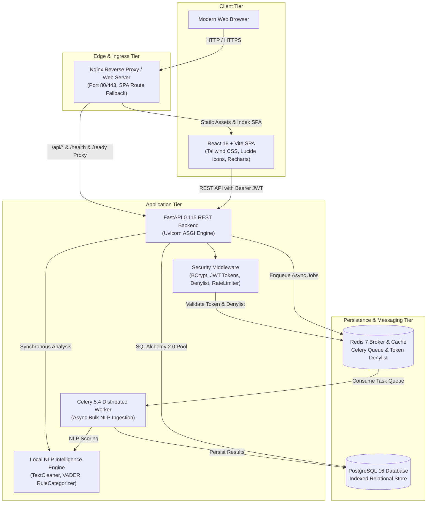

# Feedback Intelligence System

<div align="center">

[](https://github.com/Nitesh0517/feedback-intelligence-system/actions/workflows/ci.yml)
[](https://www.python.org/)
[](https://fastapi.tiangolo.com/)
[](https://react.dev/)
[](https://vitejs.dev/)
[](https://www.postgresql.org/)
[](https://docs.celeryq.dev/)
[-brightgreen.svg)](docs/TESTING.md)
[](LICENSE)

An enterprise-ready AI/ML platform that collects customer feedback from multiple touchpoints, normalizes and cleans unstructured text, evaluates sentiment scores and operational categories, detects emerging temporal trends and dissatisfaction spikes, and delivers actionable business intelligence through a modern executive React dashboard.

[Explore Architecture](docs/ARCHITECTURE.md) • [REST API Reference](docs/API.md) • [Testing Guide](docs/TESTING.md) • [Production Deployment](docs/DEPLOYMENT.md)

</div>

---

## Quick Access & URLs

| Service / Interface | Local Dev Environment | Docker Compose Environment | Description |
| :--- | :--- | :--- | :--- |
| **Frontend Application** | [`http://localhost:5173`](http://localhost:5173) | [`http://localhost:3000`](http://localhost:3000) | Interactive React 18 + Vite executive dashboard |
| **Backend REST API** | [`http://localhost:8000`](http://localhost:8000) | [`http://localhost:8000`](http://localhost:8000) | FastAPI ASGI server & application endpoints |
| **Swagger UI Docs** | [`http://localhost:8000/api/v1/docs`](http://localhost:8000/api/v1/docs) | [`http://localhost:8000/api/v1/docs`](http://localhost:8000/api/v1/docs) | Interactive OpenAPI interactive test console |
| **ReDoc Documentation** | [`http://localhost:8000/api/v1/redoc`](http://localhost:8000/api/v1/redoc) | [`http://localhost:8000/api/v1/redoc`](http://localhost:8000/api/v1/redoc) | Comprehensive static API documentation |
| **Liveness Health Probe** | [`http://localhost:8000/health`](http://localhost:8000/health) | [`http://localhost:8000/health`](http://localhost:8000/health) | Container & process liveness validation |
| **Readiness Health Probe** | [`http://localhost:8000/ready`](http://localhost:8000/ready) | [`http://localhost:8000/ready`](http://localhost:8000/ready) | PostgreSQL & Redis broker connectivity probe |
| **GitHub Repository** | [Nitesh0517/feedback-intelligence-system](https://github.com/Nitesh0517/feedback-intelligence-system) | — | Main source code repository |

---

## 1. Problem Statement & Solution

### The Business Challenge
Modern product and operations teams receive thousands of unstructured customer reviews, support tickets, and survey verbatims across fragmented channels (web forms, emails, mobile apps, social media, and in-store surveys). Manually reading, tagging, and synthesizing feedback causes:
- **Delayed Incident Response:** Operational bugs, pricing backlash, or delivery bottlenecks remain unnoticed for weeks.
- **Biased Prioritization:** Feature roadmaps are skewed by vocal edge-case users rather than quantifiable sentiment trends.
- **Siloed Insights:** Executive leadership lacks real-time visibility into cross-departmental customer satisfaction.

### The Feedback Intelligence Solution
The **Feedback Intelligence System** automates the entire feedback lifecycle:
1. **Multi-Channel Ingestion:** Secure, validated ingestion with source channel and customer cohort tagging.
2. **Deterministic Offline AI/ML:** Zero-dependency text preprocessing, VADER compound sentiment scoring ($0.0$ to $1.0$), and multi-label operational classification across 7 business domains—requiring no third-party paid API keys.
3. **Statistical Trend & Spike Detection:** Moving-window temporal algorithms detect velocity shifts and flag anomalies when negative feedback breaches statistical thresholds.
4. **Actionable Recommendations:** Synthesizes qualitative insights into executive summaries and evidence-based operational actions.
5. **Role-Based Security & React Dashboard:** JWT authentication with instant logout revocation, role-based access control (Admin, Analyst, Viewer), and real-time interactive data visualizations.

---

## 2. Architecture Overview

### 2.1 Technical Documentation
For deep technical deep dives, refer to our dedicated guides in [`docs/`](docs/):
- **[`docs/ARCHITECTURE.md`](docs/ARCHITECTURE.md)** — Architectural principles, Mermaid component flows, entity-relationship models, and security boundaries.
- **[`docs/API.md`](docs/API.md)** — Complete OpenAPI specification, authentication headers, request schemas, and sample JSON payloads.
- **[`docs/TESTING.md`](docs/TESTING.md)** — Testing pyramid, 77 backend + 16 frontend test breakdowns, and 16 user journey verification audits.
- **[`docs/DEPLOYMENT.md`](docs/DEPLOYMENT.md)** — Production hosting options (VPS vs PaaS), Docker Compose overrides, backup/restore runbooks, and SSL configuration.

### 2.2 System Architecture Diagram



---

## 3. Technology Stack

| Domain | Technology | Key Capabilities & Purpose |
| :--- | :--- | :--- |
| **Backend Framework** | **FastAPI 0.115** | High-concurrency asynchronous Python web framework with OpenAPI / Swagger schema generation. |
| **Data Validation** | **Pydantic v2** | Strict schema validation, boundary enforcement, string sanitization, and type checking. |
| **ORM & Database** | **SQLAlchemy 2.0 & PostgreSQL 16** | Connection pooling (`pool_size=10, max_overflow=20`), `pool_pre_ping=True`, and dynamic driver normalization. |
| **Migrations** | **Alembic 1.14** | Version-controlled, reproducible schema migrations with linear revision tracking. |
| **NLP Intelligence** | **NLTK (VADER), TextBlob, Regex** | Lexical valence intensity compound scoring, negation handling, and domain-specific classification. |
| **Queue & Broker** | **Celery 5.4 & Redis 7** | Distributed asynchronous task processing for heavy batch ingestion; eager execution fallback in tests. |
| **Frontend Framework** | **React 18 & Vite 5.4** | High-performance SPA with fast HMR, component modularity, and optimized production chunking. |
| **Styling & Icons** | **Tailwind CSS & Lucide React** | Responsive design system, custom typography, color tokens, and SVG iconography. |
| **Data Visualization** | **Recharts & Chart.js** | Interactive donut charts, time-series volume trends, and operational category distribution bars. |
| **Security & Auth** | **BCrypt & PyJWT** | 12-round salted password hashing, stateless JWT issuance, and instant token revocation via denylist. |
| **Testing Frameworks** | **Pytest & Vitest** | 77 backend tests across 13 modules + 16 frontend component tests across 3 suites (100% PASS). |
| **Containerization** | **Docker & Docker Compose v2** | Multi-stage Dockerfiles, unprivileged `appuser`, resource limits, log rotation, and service health checks. |

---

## 4. Repository Directory Structure

```
feedback-intelligence-system/
├── .github/
│   └── workflows/
│       ├── ci.yml                 # Automated CI: Pytest, Vitest, Vite build, Docker validation
│       └── deploy.yml             # Manual deployment workflow blueprint with pre-deploy gates
├── backend/
│   ├── alembic/                   # Database migration environment and revision scripts
│   │   └── versions/
│   │       ├── 27fdfa7d832e_create_feedback_table.py
│   │       └── 918ce4082049_create_users_table.py
│   ├── app/
│   │   ├── api/                   # API routing & dependency injection
│   │   │   ├── deps.py            # JWT auth, user context, and role permission dependencies
│   │   │   └── v1/
│   │   │       ├── analytics.py   # Overview, sentiment, category, and trend analytics routes
│   │   │       ├── auth.py        # Registration, login, profile, and logout endpoints
│   │   │       ├── feedback.py    # Feedback CRUD, search, filter, and analyze endpoints
│   │   │       ├── health.py      # Liveness and readiness probe routes
│   │   │       ├── tasks.py       # Celery task status polling endpoints
│   │   │       └── users.py       # Admin user management and role modification routes
│   │   ├── core/                  # Configuration, logging, rate limiting, and security
│   │   ├── db/                    # SQLAlchemy engine, session factory, and base model
│   │   ├── intelligence/          # VADER sentiment analyzer, rule categorizer, trends
│   │   ├── models/                # SQLAlchemy models: Feedback, User
│   │   ├── processing/            # Text normalization, unicode cleaner, and tokenizers
│   │   ├── schemas/               # Pydantic schemas: Feedback, User, Analytics, Health
│   │   ├── services/              # Business logic: Feedback, Analysis, Auth, User, Analytics
│   │   └── tasks/                 # Celery application and background worker tasks
│   ├── tests/                     # 77 automated Pytest tests across 13 modules
│   ├── Dockerfile                 # Multi-stage production backend container definition
│   └── requirements.txt           # Declared Python backend dependencies
├── deployment/
│   ├── docker-compose.prod.yml    # Production override (closed ports, log rotation, memory limits)
│   └── nginx.prod.conf            # Production host Nginx reverse proxy template with TLS
├── docs/
│   ├── API.md                     # Complete REST API reference and payload examples
│   ├── ARCHITECTURE.md            # System architecture, Mermaid diagrams, and ERD
│   ├── DEPLOYMENT.md              # Hosting comparison, VPS runbook, backups, and troubleshooting
│   └── TESTING.md                 # Testing pyramid, coverage breakdown, and journey audit
├── frontend/
│   ├── src/
│   │   ├── components/            # Reusable UI: Charts, MetricCard, SearchBar, StatusBadge
│   │   ├── context/               # AuthContext: Session state, token storage, role helpers
│   │   ├── layouts/               # DashboardLayout: Navigation sidebar and live API health pill
│   │   ├── pages/                 # Overview, FeedbackList, FeedbackDetail, Form, Analytics, Users
│   │   └── services/              # Axios HTTP client and centralized API service functions
│   ├── Dockerfile                 # Multi-stage container: Node build -> Nginx Alpine SPA
│   ├── nginx.conf                 # Internal Nginx configuration with SPA routing fallback
│   └── package.json               # Frontend dependencies and test/build scripts
├── .env.example                   # Environment configuration template with safe placeholders
├── .gitignore                     # Git exclusion rules (secrets, venvs, databases, build artifacts)
├── docker-compose.yml             # Local multi-service orchestration (FastAPI, React, Postgres, Redis, Celery)
├── LICENSE                        # Open-source MIT License
└── README.md                      # Primary project documentation
```

---

## 5. Quickstart & Installation

### Option A: 1-Command Docker Compose (Recommended)

Run the complete multi-service stack with a single command:

```bash
# 1. Clone repository
git clone https://github.com/Nitesh0517/feedback-intelligence-system.git
cd feedback-intelligence-system

# 2. Copy environment template
cp .env.example .env

# 3. Build and launch all 5 containers
docker compose up -d --build

# 4. Apply database migrations
docker compose exec backend alembic upgrade head
```

- **Frontend Application:** Open [`http://localhost:3000`](http://localhost:3000)
- **API Documentation:** Open [`http://localhost:8000/api/v1/docs`](http://localhost:8000/api/v1/docs)

---

### Option B: Local Standalone Development (No Docker Required)

#### Prerequisites
- **Python:** 3.11+
- **Node.js:** 18+ and npm

#### 1. Setup Backend
```powershell
# Windows PowerShell
cd c:\Users\nites\Desktop\feed\feedback-intelligence-system\backend

# Create and activate virtual environment
py -3.11 -m venv .venv
.\.venv\Scripts\Activate.ps1

# Install backend dependencies
pip install -r requirements.txt

# Apply database migrations (uses SQLite fallback by default)
alembic upgrade head

# Launch FastAPI development server
uvicorn app.main:app --reload --port 8000
```

*(On Linux / macOS Bash: replace `.venv\Scripts\Activate.ps1` with `source .venv/bin/activate`)*

#### 2. Setup Frontend
```powershell
# Open a new terminal
cd c:\Users\nites\Desktop\feed\feedback-intelligence-system\frontend

# Install dependencies
npm install

# Launch Vite development server
npm run dev
```

Open [`http://localhost:5173`](http://localhost:5173) in your browser.

---

## 6. Default User Accounts & Role Permissions

The system implements Role-Based Access Control (RBAC). In development, you can register new `analyst` or `viewer` accounts via `/register`. To log in as `admin`, seed credentials via environment variables:

| Role | Default Email / Credentials | Accessible Routes | Permitted Operations |
| :--- | :--- | :--- | :--- |
| **Admin** | `admin@feedbacksystem.com`<br/>*Configured via `.env`* | All Routes + `/users` | Full system control: User management, role modification, account status toggle, feedback deletion, and full analytics. |
| **Analyst** | Publicly register at `/register` | `/`, `/feedback`, `/submit`, `/analytics` | Submit customer feedback, run synchronous and asynchronous AI analysis, update record statuses, and inspect analytics. |
| **Viewer** | Publicly register at `/register` | `/`, `/feedback`, `/analytics` | Read-only access: View feedback records, inspect details, and review executive analytics charts. |

---

## 7. AI/ML Intelligence Pipeline

```mermaid
flowchart LR
    Raw[Raw Customer Feedback] --> Cleaner[Text Cleaner & Unicode Normalizer]
    Cleaner --> CleanText[Normalized Text]
    
    CleanText --> SentEngine[VADER + Polarity Engine]
    CleanText --> CatEngine[Multi-Label Keyword Categorizer]
    
    SentEngine --> Compound[Compound Intensity Score: -1.0 to +1.0]
    Compound --> Normalized[Normalized Score: 0.0 to 1.0<br/>Label: positive | neutral | negative]
    
    CatEngine --> Category[Domain Category:<br/>Product Quality, Customer Support,<br/>Pricing, Delivery, UX, Feature Request]
    
    Normalized --> DB[(Update Feedback Record)]
    Category --> DB
```

### 1. Text Preprocessing (`app/processing/cleaner.py`)
- **Unicode NFKC Normalization:** Converts typographic quotes, em-dashes, and non-breaking spaces into standardized UTF-8 characters.
- **Whitespace Collapsing:** Replaces tabs, newlines, and multi-spaces with single space delimiters.
- **Context Preservation:** Retains emotional punctuation (`!`, `?`) and negation tokens (`not`, `never`, `didn't`) critical for sentiment scoring.

### 2. Sentiment Scoring (`app/intelligence/sentiment_analyzer.py`)
- Computes VADER lexical valence compound scores bounded in $[-1.0, +1.0]$.
- Applies negation window inversion: negations within 3 tokens invert sentiment valence.
- Maps compound score linearly to $[0.0, 1.0]$:
  $$\text{sentiment\_score} = \frac{\text{compound} + 1.0}{2.0}$$
- Classifies discrete labels: `positive` ($\ge 0.05$), `negative` ($\le -0.05$), and `neutral` (between $-0.05$ and $0.05$).

### 3. Operational Categorization (`app/intelligence/categorizer.py`)
Matches weighted domain phrases and keywords across seven business categories:
1. **Product Quality:** defect, bug, hardware, broken, crash, glitch, durable, quality.
2. **Customer Support:** agent, representative, helpdesk, ticket, wait time, response, rude.
3. **Pricing:** expensive, refund, price, billing, subscription, charge, discount, cost.
4. **Delivery:** courier, shipping, tracking, package, late, delayed, arrived, transit.
5. **User Experience:** UI, interface, navigation, layout, confusing, button, font.
6. **Feature Request:** feature, please add, wish, would like, integrate, suggestion.
7. **Other:** Safe fallback when evidence confidence falls below threshold.

---

## 8. REST API Reference

All protected endpoints require an `Authorization: Bearer <JWT>` header. Detailed schemas and payload examples are documented in [`docs/API.md`](docs/API.md).

### Summary Endpoint Table

| Method | Endpoint | Minimum Role | Description |
| :--- | :--- | :--- | :--- |
| `POST` | `/api/v1/auth/register` | Public | Register a new user (`analyst` or `viewer`) |
| `POST` | `/api/v1/auth/login` | Public | Authenticate user credentials and return JWT |
| `GET` | `/api/v1/auth/me` | Authenticated | Retrieve profile and role of authenticated user |
| `POST` | `/api/v1/auth/logout` | Authenticated | Invalidate JWT token via denylist |
| `GET` | `/api/v1/feedback` | Authenticated | Paginated feedback feed with search, category, and sentiment filters |
| `POST` | `/api/v1/feedback` | Analyst, Admin | Ingest new customer feedback record |
| `GET` | `/api/v1/feedback/{id}` | Authenticated | Retrieve specific feedback item details |
| `PATCH` | `/api/v1/feedback/{id}` | Analyst, Admin | Update feedback text, status, or category |
| `DELETE` | `/api/v1/feedback/{id}` | Admin | Permanently delete a feedback record |
| `POST` | `/api/v1/feedback/{id}/analyze` | Analyst, Admin | Run synchronous sentiment and category analysis |
| `POST` | `/api/v1/feedback/{id}/analyze-async` | Analyst, Admin | Enqueue asynchronous Celery analysis job (HTTP 202) |
| `POST` | `/api/v1/feedback/batch-analyze` | Analyst, Admin | Synchronously batch analyze unanalyzed items |
| `GET` | `/api/v1/tasks/{task_id}` | Authenticated | Inspect asynchronous Celery task status and results |
| `GET` | `/api/v1/analytics/overview` | Authenticated | Top-level KPI counts and sentiment percentages |
| `GET` | `/api/v1/analytics/sentiment` | Authenticated | Sentiment distribution and average score |
| `GET` | `/api/v1/analytics/categories` | Authenticated | Distribution of feedback across 7 operational categories |
| `GET` | `/api/v1/analytics/trends` | Authenticated | Time-series data points, negative spike alerts, and summaries |
| `GET` | `/api/v1/users` | Admin | List user accounts directory |
| `PATCH` | `/api/v1/users/{id}/role` | Admin | Update operational role of a user |
| `PATCH` | `/api/v1/users/{id}/status` | Admin | Activate or deactivate user account |
| `DELETE` | `/api/v1/users/{id}` | Admin | Delete a user account (with last-admin protection) |
| `GET` | `/health` | Public | Liveness probe returning service status |
| `GET` | `/ready` | Public | Readiness probe validating PostgreSQL and Redis connectivity |

---

## 9. Comprehensive Testing & Quality Assurance

The system maintains a comprehensive automated testing pyramid with **93 automated tests passing at 100%**. See [`docs/TESTING.md`](docs/TESTING.md) for full audit reports.

### Run Test Suites

#### Backend Tests (Pytest — 77 Tests)
```powershell
cd backend
.\.venv\Scripts\pytest.exe -v --tb=short
```

#### Frontend Tests (Vitest — 16 Tests)
```powershell
cd frontend
npm test -- --run
```

#### Production Build Verification
```powershell
cd frontend
npm run build
```

---

## 10. Production Deployment Runbook

For complete infrastructure specifications, refer to [`docs/DEPLOYMENT.md`](docs/DEPLOYMENT.md).

### Deploying to Linux VPS with Docker Compose (Ubuntu 22.04 / 24.04 LTS)

```bash
# 1. Connect to server and clone repository
cd /opt
sudo git clone https://github.com/Nitesh0517/feedback-intelligence-system.git
cd feedback-intelligence-system

# 2. Configure production environment
sudo cp .env.example .env
sudo nano .env  # Update SECRET_KEY, POSTGRES_PASSWORD, BACKEND_CORS_ORIGINS

# 3. Launch hardened production containers
sudo docker compose -f docker-compose.yml -f deployment/docker-compose.prod.yml up -d --build

# 4. Execute database migrations
sudo docker compose exec -T backend alembic upgrade head

# 5. Verify container health
sudo docker compose ps
curl -f http://localhost:8000/ready
```

---

## 11. Project Presentation Walkthrough

Use this 5-minute workflow for portfolio showcases, technical interviews, and project presentations:

1. **Authentication & RBAC:** Log in at [`http://localhost:5173`](http://localhost:5173). Highlight role-aware navigation: `Analyst` users can access **Submit Feedback**, whereas **User Management** is strictly reserved for `Admin`.
2. **Executive Overview:** Observe the live KPI metric cards (Total Feedback, Sentiment Distribution, Analyzed Percentage) and the live API health badge in the sidebar.
3. **Feedback Ingestion:** Go to `/submit` and enter: *"The checkout process was fast and customer support resolved my issue in 2 minutes! Truly outstanding."* Submit and verify immediate redirection to the feedback detail page.
4. **AI/ML Intelligence:** Verify the record has been evaluated as `positive` sentiment (score ~0.85–0.95) and classified into `Customer Support`.
5. **Analytics & Trends:** Navigate to `/analytics`. Inspect the interactive Sentiment donut chart, Category distribution bars, time-series volume trends, and dynamically generated AI summary and recommendations.
6. **Session Invalidation:** Click **Sign Out**. Demonstrate that the token denylist prevents replaying the expired JWT.

---

## 12. License

This project is licensed under the **MIT License** — see the [LICENSE](LICENSE) file for details.
