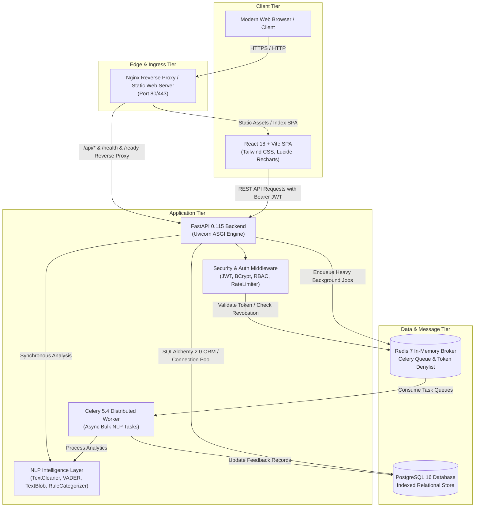
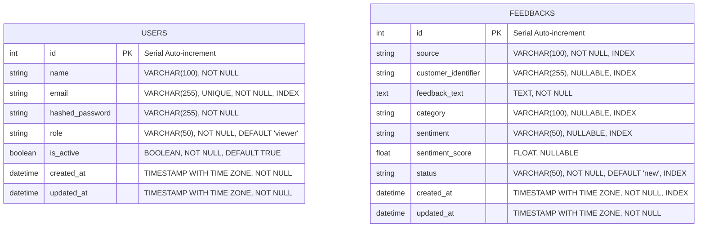

# Architecture & Technical Design

## 1. System Overview

The **Feedback Intelligence System** is an enterprise-grade customer feedback analytics platform that automates the collection, preprocessing, natural language intelligence analysis (sentiment classification and multi-label operational categorization), trend monitoring, and executive reporting of customer feedback across multi-channel touchpoints.

### Core Architecture Principles
- **Separation of Concerns:** Independent API, worker, frontend, caching, and persistence tiers.
- **Resilience & Asynchrony:** Dual execution paths (synchronous low-latency NLP analysis for interactive edits; asynchronous distributed Celery/Redis background task queues for bulk ingestion).
- **Zero Third-Party API Dependence:** Offline, local NLP engines (VADER + TextBlob) requiring no external paid API keys or cloud tokens.
- **Defense in Depth:** Mandatory token authentication, in-memory token revocation on logout, strictly enforced role-based access control (RBAC), security headers (CSP, HSTS, X-Frame-Options), rate limiting, and sanitized error logging.



---

## 2. Component Responsibilities

| Component | Technology | Primary Responsibilities |
| :--- | :--- | :--- |
| **Frontend Application** | React 18, Vite, React Router 6, Tailwind CSS | Responsive dashboard UI, authenticated session management, role-aware routing, interactive charts (Recharts), dynamic feedback filtering, and pagination. |
| **API Gateway / Server** | FastAPI, Starlette, Uvicorn | RESTful API endpoints, request validation via Pydantic v2, JWT issuance & verification, security headers, rate limiting, and database transaction lifecycles. |
| **NLP Intelligence Layer** | NLTK (VADER), TextBlob, Custom Regex Categorizer | Zero-dependency text cleaning, sentiment intensity compound scoring (-1.0 to +1.0) normalized to (0.0 to 1.0), and keyword-based operational categorization with fallback strategies. |
| **Background Processing** | Celery 5.4, Redis 7 | Asynchronous job dispatching (`analyze_feedback_task`, `batch_analyze_feedback_task`), task progress tracking, and non-blocking bulk data analysis. |
| **Relational Storage** | PostgreSQL 16 (or SQLite in local test) | ACID transactional persistence for customer feedback, user identities, roles, hashed credentials, and analytical metadata. |
| **In-Memory Cache / Broker** | Redis 7 | Celery message broker, task result backend, and real-time JWT denylist for instant logout revocation. |
| **Schema Migration** | Alembic 1.14 | Version-controlled, reproducible database schema migrations. |

---

## 3. Database Schema & Data Models

The persistence layer is governed by SQLAlchemy 2.0 with strict foreign constraints, nullability rules, and btree indexing for query optimization.



### Table Specifications

#### 1. `feedbacks` Table
- `id` (INTEGER, Primary Key): Unique auto-incrementing identifier.
- `source` (VARCHAR(100), Indexed): Ingestion channel (`Web Form`, `Mobile App`, `Email`, `Survey`, `Twitter/Social`, `Customer Support`, `In-Store`).
- `customer_identifier` (VARCHAR(255), Indexed, Nullable): Customer account, email, or external reference ID.
- `feedback_text` (TEXT, Not Null): Raw feedback content (constrained between 3 and 10,000 characters).
- `category` (VARCHAR(100), Indexed, Nullable): Operational classification (`Product Quality`, `Customer Support`, `Pricing`, `Delivery`, `User Experience`, `Feature Request`, `Other`).
- `sentiment` (VARCHAR(50), Indexed, Nullable): Categorical sentiment (`positive`, `neutral`, `negative`).
- `sentiment_score` (FLOAT, Nullable): Normalized score between `0.0` and `1.0`.
- `status` (VARCHAR(50), Indexed, Default `'new'`): Workflow status (`new`, `reviewed`, `archived`).
- `created_at` (TIMESTAMP, Indexed): UTC timestamp of ingestion.
- `updated_at` (TIMESTAMP): UTC timestamp of last modification.

#### 2. `users` Table
- `id` (INTEGER, Primary Key): Unique account ID.
- `name` (VARCHAR(100), Not Null): Full name of system user.
- `email` (VARCHAR(255), Unique, Indexed, Not Null): Login email.
- `hashed_password` (VARCHAR(255), Not Null): BCrypt salted password hash.
- `role` (VARCHAR(50), Not Null, Default `'viewer'`): Role (`admin`, `analyst`, `viewer`).
- `is_active` (BOOLEAN, Default `True`): Account activation flag.
- `created_at` (TIMESTAMP): Registration timestamp.
- `updated_at` (TIMESTAMP): Account update timestamp.

---

## 4. NLP Intelligence & Sentiment Pipeline

The NLP analysis pipeline requires no external network requests or paid API tokens. It runs completely self-contained within Python:

```mermaid
flowchart LR
    RawInput[Raw Customer Text] --> Cleaner[Text Cleaner & Normalizer]
    Cleaner --> CleanText[Cleaned Unicode Text]
    CleanText --> SentAnalysis[Sentiment Engine<br/>VADER + TextBlob]
    CleanText --> Categorizer[Rule-Based Keyword Categorizer]
    
    SentAnalysis --> SentScore[Compound Score: -1.0 to +1.0]
    SentScore --> Normalizer[Normalized Score: 0.0 to 1.0<br/>Label: positive | neutral | negative]
    
    Categorizer --> CategoryLabel[Category: Product Quality, Support, Delivery, etc.]
    
    Normalizer --> DBUpdate[(Update Feedback Record)]
    CategoryLabel --> DBUpdate
```

### Sentiment Logic
1. **Cleaning:** Strips control characters and normalizes whitespace while preserving emotional punctuation (`!`, `?`) and emojis.
2. **Scoring:** Calculates VADER sentiment compound score. In edge cases, complements with TextBlob polarity.
3. **Thresholding:**
   - `compound >= 0.05` $\rightarrow$ `positive`
   - `compound <= -0.05` $\rightarrow$ `negative`
   - `-0.05 < compound < 0.05` $\rightarrow$ `neutral`
4. **Normalized Score:** Mapped linearly to $[0.0, 1.0]$ via $\text{score} = \frac{\text{compound} + 1.0}{2.0}$.

### Categorization Logic
A weighted dictionary mapping matches domain-specific keywords and regular expressions across seven distinct business domains:
- **Product Quality:** defect, broken, bug, crash, glitch, quality, durable, hardware, faulty.
- **Customer Support:** agent, representative, helpdesk, wait time, chat, ticket, rude, helpful.
- **Pricing:** expensive, refund, billing, cost, subscription, price, discount, charge.
- **Delivery:** shipping, courier, tracking, delayed, package, arrived, late, transit.
- **User Experience:** UI, interface, navigation, confusing, layout, intuitive, design, slow.
- **Feature Request:** feature, please add, wish, would like, integrate, suggestion.
- **Other:** Default fallback if no domain thresholds are met.

---

## 5. Security & Access Control Architecture

### Authentication & Token Invalidation
- **Algorithm:** HMAC-SHA256 (HS256) JWT signed with high-entropy `SECRET_KEY`.
- **Stateless Verification:** FastAPI dependency extracts and decodes the token from `Authorization: Bearer <token>`.
- **Instant Logout (Token Revocation):** When a user logs out (`POST /api/v1/auth/logout`), the token's remaining TTL is calculated and added to an in-memory / Redis denylist. Any subsequent request with that token is immediately rejected with HTTP 401 Unauthorized.

### Role-Based Access Control (RBAC) Matrix

| Endpoint / Action | Viewer | Analyst | Admin |
| :--- | :---: | :---: | :---: |
| View Feedback Feed & Details (`GET /feedback`) | Yes | Yes | Yes |
| View Analytics & Charts (`GET /analytics/*`) | Yes | Yes | Yes |
| Submit New Feedback (`POST /feedback`) | No (403) | Yes | Yes |
| Run Synchronous / Async AI Analysis (`POST /analyze`) | No (403) | Yes | Yes |
| Update Feedback Status / Content (`PATCH /feedback`) | No (403) | Yes | Yes |
| Delete Feedback Records (`DELETE /feedback`) | No (403) | No (403) | Yes |
| View System User Directory (`GET /users`) | No (403) | No (403) | Yes |
| Modify User Roles & Account Status (`PATCH /users`) | No (403) | No (403) | Yes |
| Delete System Accounts (`DELETE /users`) | No (403) | No (403) | Yes |

### Security Headers & Rate Limiting
- **Security Headers Middleware:** Adds `X-Content-Type-Options: nosniff`, `X-Frame-Options: DENY`, `X-XSS-Protection: 1; mode=block`, `Strict-Transport-Security` (in production), and `Content-Security-Policy`.
- **Rate Limiting:** Protects `/auth/login` and `/auth/register` (15 requests/minute default) to prevent brute-force credential stuffing. General API endpoints are governed by a configurable 60 requests/minute threshold.
- **Sanitized Logging:** Passwords, Authorization headers, and sensitive tokens are strictly redacted from application logs before emission.

---

## 6. Background Task Queue (Celery & Redis)

When processing large batches of feedback (e.g. historical CSV imports or scheduled bulk reconciliations), the system decouples HTTP request cycles from computation:
- **Eager Execution Mode:** When `ENVIRONMENT=testing` or Redis is omitted in local dev, tasks execute synchronously inline (`task_always_eager=True`).
- **Distributed Production Mode:** When Redis is available, tasks are dispatched asynchronously returning HTTP 202 Accepted with a unique `task_id`.
- Clients can poll `GET /api/v1/tasks/{task_id}` for real-time progress (`PENDING`, `STARTED`, `SUCCESS`, `FAILURE`).
